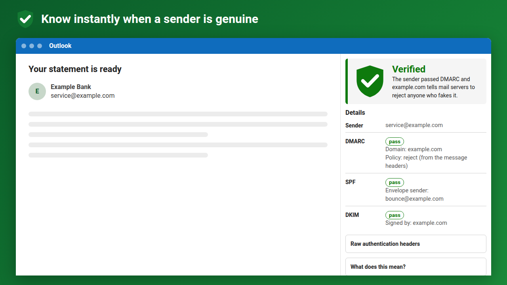

# DMARC Shield

[](https://github.com/berndverhofstadt/dmarc-shield/actions/workflows/ci.yml)
[](LICENSE)

An open-source Outlook add-in that shows, at a glance, whether an email really
comes from the domain it claims. It reads the **DMARC, SPF, DKIM and ARC**
results your own mail server recorded and turns them into one clear verdict.
Everything happens **inside Outlook, on your device**: no backend, no telemetry,
and the headers never leave the client.



| Result | Meaning |
| --- | --- |
| 🟢 **Verified** | DMARC passed (SPF or DKIM aligned with the From domain) **and** the domain publishes an enforced `p=reject`, or the message is internal to your organisation. |
| 🔵 **Authenticated** | DMARC passed, but the policy is `quarantine`/`none`, partly enforced, or not visible. |
| 🔴 **Not protected** | No DMARC policy, DMARC failed, no authentication results, or signs of forgery (forged/contradicting headers, broken ARC, mismatched sender, lookalike domain). |
| ⚪ **Not supported** | This Outlook client can't give add-ins the message headers. |

Website: <https://berndverhofstadt.github.io/dmarc-shield/> ·
[Privacy](PRIVACY.md) · [Security](SECURITY.md) · [Design](DESIGN.md)

## Features

- **Only trusts your own mail server.** Senders can insert fake
  `Authentication-Results` headers. DMARC Shield only trusts the topmost one and
  flags duplicate or contradicting headers as forgery. Lower headers,
  `ARC-Authentication-Results` and `X-MS-Exchange-Authentication-Results` are
  shown for information only.
- **Forwarded mail (ARC).** When your mail server vouches for the ARC chain
  (`arc=pass`, or Exchange `compauth` reason 130), the original DMARC result
  recorded by the first forwarder is used. This is always labelled with the
  forwarder's name.
- **Lookalike domains.** Detects punycode, mixed alphabets, confusable
  characters, lookalikes of your own domain, and Reply-To domains that imitate
  the sender.
- **Honest about policies.** It only claims `p=reject` when the headers say so.
  Exchange Online doesn't record the policy, so there's an **opt-in**,
  privacy-preserving DNS-over-HTTPS lookup of the sender's `_dmarc` record
  (Quad9 by default, or Cloudflare or Google).
- **Brand logos (BIMI), opt-in.** 🟢 when the logo is backed by a Verified or
  Common Mark Certificate, validated in the add-in against the bundled
  DigiCert, SSL.com and GlobalSign mark roots. 🔵 for a published logo without
  a (checkable) certificate. ⚪ for no BIMI. Only for mail that passed DMARC
  under `quarantine`/`reject`.
- **Info bar** on the message, plus a task pane with a plain-language "what
  does this mean", raw headers, settings and a pinnable pane.
- Light/dark/high-contrast, WCAG AA, keyboard accessible, works at narrow widths.
- English, Nederlands, Français, Deutsch.

## Supported Outlook clients

| Client | Supported |
| --- | --- |
| Outlook on the web (Microsoft 365 and Outlook.com) | ✅ |
| New Outlook for Windows | ✅ |
| Classic Outlook for Windows (Microsoft 365, version 1910+) | ✅ |
| Outlook for Mac | ✅ |
| Outlook for iOS / Android | ❌ see below |
| Exchange Server (on-premises) mailboxes | ❌ (needs Mailbox API 1.8) |

> [!IMPORTANT]
> **Mobile is not supported, because of a limitation in Microsoft's API.**
> Outlook for iOS and Android only support the Outlook add-in API up to
> Mailbox requirement set 1.5. `getAllInternetHeadersAsync` (Mailbox 1.8) is not
> on Microsoft's list of later APIs enabled for mobile, so a mobile add-in
> **cannot read message headers**, and without headers there's nothing to check.
> The add-in is therefore not offered on mobile. We'll add mobile support as soon
> as Microsoft enables header access there; see
> [Outlook JavaScript APIs supported in Outlook on mobile devices](https://learn.microsoft.com/office/dev/add-ins/outlook/outlook-mobile-apis).

## Limitations

- **Runs when the pane is open.** Outlook on the web, new Outlook and Mac have
  no "on message read" event for add-ins (`OnMessageReadWithCustomHeader` is
  preview-only, classic Windows only). Open the pane, or **pin it** (Microsoft
  365 work/school accounts) to check every message you select. The info bar is
  only added while the pane is open or pinned.
- **Reads, doesn't re-verify.** Results are what your mail server recorded.
  DMARC Shield can't verify DKIM/ARC signatures itself (Office.js doesn't expose
  the raw MIME message).
- **Policy visibility.** Without the optional DNS lookup, Exchange Online mail
  that passes DMARC is shown as *Authenticated* (blue), because Exchange doesn't
  record `p=` in the headers.
- **BIMI.**
  - Microsoft doesn't support BIMI, so in Outlook.com/Microsoft 365
    mailboxes the add-in checks it itself. That means downloading the logo
    and certificate from the sender's BIMI host, which sees your IP address.
    It's opt-in, see [PRIVACY.md](PRIVACY.md).
  - Some certificate hosts (notably `vmc.digicert.com`, Apple, Valimail) don't
    allow browsers to download their files (CORS), so those brands show blue
    with "certificate couldn't be checked".
  - Revocation (OCSP/CRL) and Certificate Transparency aren't checked.
- **Heuristics.** Lookalike detection and organisational-domain guesses are
  offline heuristics (no brand list, no Public Suffix List) and can miss
  things. A verified sender proves origin, not that content is safe.

## Enterprise networks: use your own DNS resolver

Web add-ins can't use the device's DNS resolver: browsers have no API for DNS
lookups, so the policy and BIMI lookups use DNS-over-HTTPS (RFC 8484). Many
corporate networks block public DoH resolvers. Use your organisation's own
DoH endpoint instead (for example Windows Server 2025 DNS, Cisco Umbrella,
Zscaler, Infoblox, Cloudflare Gateway, NextDNS or AdGuard):

- **Per user:** *Settings → DNS resolver → Custom* and enter the URL.
- **For the whole organisation (admins):** build a manifest pinned to your
  resolver and deploy it through the Microsoft 365 admin center:

  ```sh
  npm run manifest:org -- --org-doh=https://doh.corp.example/dns-query
  # → manifest.org.xml (task pane URL gets ?doh=…)
  ```

  With an organisation resolver set, the pane uses **only** that resolver. The
  public resolvers and retry buttons are hidden, and the settings show which
  resolver IT configured.

The endpoint must answer RFC 8484 `GET ?dns=` requests **and allow browser
requests (CORS: `Access-Control-Allow-Origin: *` or
`https://berndverhofstadt.github.io`)**. If yours doesn't, put a small reverse
proxy in front that adds the header.

## Install

- **Microsoft Marketplace:** search for *DMARC Shield* under *Apps / Get Add-ins*
  in Outlook (once published).
- **Organisation-wide (admins):** Microsoft 365 admin center → *Settings →
  Integrated apps → Upload custom apps* → *Office Add-in* → manifest URL
  `https://berndverhofstadt.github.io/dmarc-shield/manifest.xml`.
- **Just you:** download `manifest.xml` from the
  [latest release](https://github.com/berndverhofstadt/dmarc-shield/releases),
  open [aka.ms/olksideload](https://aka.ms/olksideload) in Outlook on the web,
  then *My add-ins → Custom add-ins → Add from file*.

## Development

Requirements: Node.js 20.19+ (22 LTS recommended), a Microsoft 365 or
Outlook.com mailbox.

```sh
npm install
npx office-addin-dev-certs install   # trusted localhost certificate (once)
npm run dev                          # https://localhost:3000, writes manifest.dev.xml
```

The dev manifest uses its own add-in ID and the name *DMARC Shield (dev)*, so it
never clashes with an installed release.

### Sideloading

**Outlook on the web (any OS):** with `npm run dev` running, open
[aka.ms/olksideload](https://aka.ms/olksideload) → *My add-ins → Custom add-ins
→ Add a custom add-in → Add from file* → `manifest.dev.xml`. Open a message →
*Apps* → *DMARC Shield (dev)*. Sideloaded add-ins roam with your mailbox, so the
same add-in also appears in new Outlook for Windows and Outlook for Mac on that
machine.

**Classic Outlook for Windows:** `npm start` sideloads `manifest.dev.xml` and
starts the dev server (`office-addin-debugging`); `npm run stop` removes it.

**Outlook for Mac / new Outlook for Windows:** sideload through Outlook on the
web as above (it roams), or use *Apps → Get Add-ins → My add-ins → Add a custom
add-in → Add from file* in the client itself.

**Linux:** `office-addin-dev-certs install` needs `sudo` to add its CA to the
system store. Chromium-based browsers use the NSS database instead:
`certutil -d sql:$HOME/.pki/nssdb -A -t "C,," -n "Office Add-in Dev CA" -i ~/.office-addin-dev-certs/ca.crt`
(remove later with `certutil -d sql:$HOME/.pki/nssdb -D -n "Office Add-in Dev CA"`).

**Mobile:** not supported (see above).

**Without Outlook:** `https://localhost:3000/taskpane.html?demo=verified` (also
`authenticated`, `arc`, `unprotected`, `lookalike`, `internal`; add `&lang=nl`)
renders the pane with built-in sample headers.

### Scripts

| Command | |
| --- | --- |
| `npm run dev` | Dev server + `manifest.dev.xml` |
| `npm start` / `npm run stop` | Sideload into classic Outlook on Windows |
| `npm run build` | Typecheck, build `dist/`, write `dist/manifest.xml` |
| `npm test` / `npm run test:coverage` | Vitest (coverage gate ≥ 90% on parser + DNS) |
| `npm run lint` / `npm run format` | ESLint + Prettier |
| `npm run validate` | `office-addin-manifest validate dist/manifest.xml` |
| `npm run icons` | Render icons from `brand/*.svg` |
| `node scripts/screenshots.mjs` | Store/website screenshots (needs dev server + Edge/Chrome) |

Set `ADDIN_BASE_URL=https://example.org/path/` when building to host somewhere
else (e.g. Azure Static Web Apps; `public/staticwebapp.config.json` adds the CSP
as real HTTP headers there).

### Layout

```
src/parser/   pure header/A-R/ARC/address/lookalike parsing and the verdict engine
src/dns/      opt-in DNS-over-HTTPS (the only network code; ESLint enforces this)
src/office/   thin Office.js adapter (headers, info bar)
src/ui/       view model, DOM helpers, theme, CSS
src/i18n/     en / nl / fr / de
src/*.html    task pane, function file, website pages
manifest/     add-in only (XML) manifest template
test/         Vitest suites and header fixtures
publishing/   Marketplace listing, checklist and certification notes
```

## Contributing

See [CONTRIBUTING.md](CONTRIBUTING.md). Redacted real-world headers that
produce a wrong verdict are especially welcome as test fixtures.

## License

[MIT](LICENSE) © 2026 Bernd Verhofstadt
